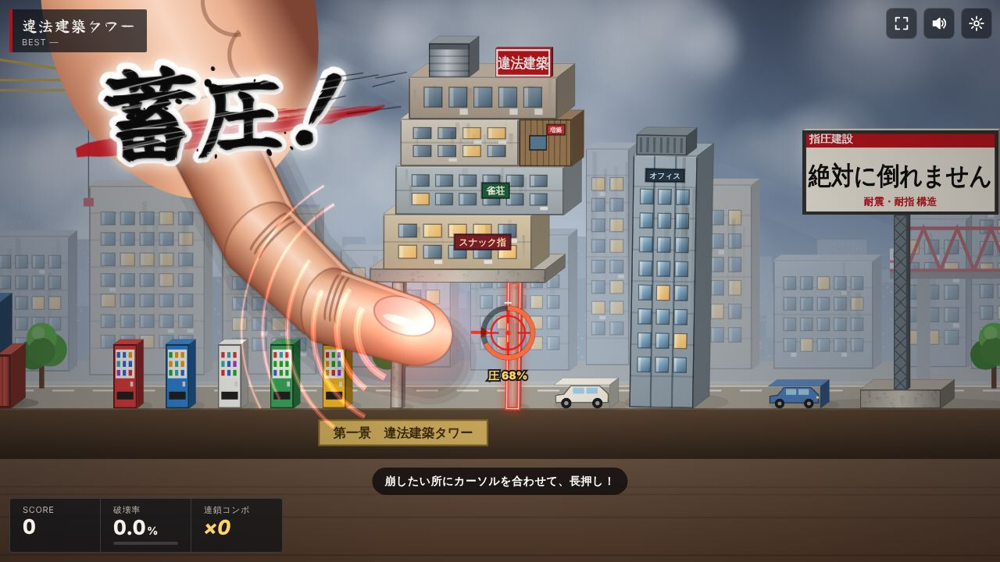
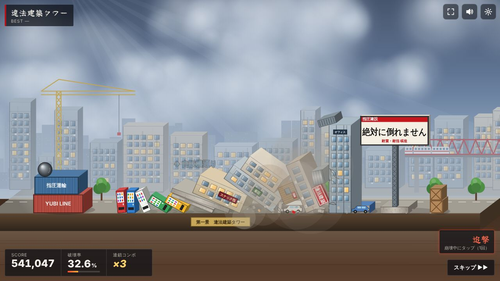

# 指一本。

**世界は、たった一指で崩れる。**

狙点！ × 蓄圧！ × 解放！ ＝ 一撃崩壊。
超シリアスな必殺技演出と、バカバカしい物理破壊の落差を楽しむ、ワンフィンガー物理破壊シミュレーションです。
ブラウザでそのまま遊べます（インストール不要・PC／スマートフォン対応）。




## 遊び方

| 段階 | PC | スマホ |
| --- | --- | --- |
| **狙点！** | マウスで崩したい所に照準を合わせる | 崩したい所に指を置く |
| **蓄圧！** | 左ボタンを長押し（スペースキーでも可） | そのまま長押し |
| **解放！** | 離すとデコピン | 離すとデコピン |
| **追撃** | 崩壊中にクリック（1 回だけ） | 崩壊中にタップ（1 回だけ） |

- 指は **狙った面に垂直に、外側から** 弾きます。照準の赤い矢印が弾く向きです。
- 蓄圧ゲージが満ちた直後の短い間に離すと **会心**（威力 115%）。溜めすぎると **過蓄圧** で照準がぶれ、威力も落ちます。
- 長押し中に指（マウス）を動かすと、照準を少しずつ微調整できます。指で照準が隠れるときに使ってください。
- **狙いアシスト**（設定でオン／オフ）：弱点の近くを押すと照準が吸い付き、物体の少し外を押しても一番近い輪郭に合います。
- 崩壊が落ち着くと結果が出ます。「スキップ」で早送り。**R キー／スペース** ですぐ再挑戦。
- 右上のボタン：全画面・音のオン／オフ・設定（音量、揺れとフラッシュを弱める、弱点のヒント、画質）。

## スコア

総合スコア ＝ 破壊ポイント ＋ 連鎖ボーナス ＋ 目標達成ボーナス

- **破壊ポイント**：倒した・砕いた物ごとの点数。そのときの連鎖コンボが大きいほど倍率が上がる。
- **連鎖ボーナス**：動いている物が、まだ動いていない別の物にぶつかるたびに加算。間を空けずにつなぐほど大きい。
- **目標達成**：看板撃破／三棟連鎖（タワー・オフィスビル・看板）／一撃全壊（追撃なしで全壊）／全壊／大連鎖。
- **被害総額**：ゲーム内の架空の単位「デコ」で表す“ギャグ指標”です。現実の金額とは関係ありません。

ベスト記録と設定は端末内（localStorage）にだけ保存されます。

## ステージ

| 景 | 名前 | 見どころ |
| --- | --- | --- |
| 第一景 | 違法建築タワー | 細い柱の上の塔、鉄球と自販機のドミノ、「絶対に倒れません」の看板 |
| 第二景 | シャッター商店街 | 背の順に並んだ細長い店のドミノ倒し。最後に商店街アーチ |
| 第三景 | コンテナヤード | クレーンに吊られた鉄球。押せば揺れて、戻ってくる |
| 第四景 | 天守閣 | 石垣の上の天守。てっぺんの金のしゃちほこを落とせ |
| 本日 | 日替わり違法建築 | 日付から毎日ちがう街を自動で作る。毎日ベストが別 |

前の景で ★1（破壊率 20%）を取ると次の景が開きます。★ は破壊率 20%／40%／全壊（60%。天守閣は 50%）。

## 遊びのおまけ

- **リプレイ**：結果画面から、同じ一撃をスローモーションとカメラワーク付きでもう一度（同じ入力で物理を計算し直すので完全に同じ崩れ方）
- **技名**：狙った物・タイミング・連鎖・追撃から「奥義・細い柱砕き」のような技名が付く
- **号外**：結果に新聞の見出し風のひとこと
- **指の記録**：実績 14 種（会心・圧砕・二十連鎖・一撃全壊・全景制覇 など）。ステージ選択画面で確認
- スマホでは解放の瞬間に振動（対応端末のみ。「揺れとフラッシュを弱める」でオフ）

## 第一景「違法建築タワー」

細い柱の上に増築を重ねた塔、隣のオフィスビル、コンテナの上の鉄球、自販機の並び、そして「絶対に倒れません」の巨大看板。
すべて長方形と円の剛体です（人間キャラクターは出てきません）。

攻略の入口は一つではありません。

- 鉄球を弾いて自販機をドミノ倒しに。**強すぎると鉄球は自販機を飛び越えて** 塔の足元へ。
- 塔を支える細い柱を弾く。どちらの柱を外すかで、塔の倒れる向きが変わる。
- 威力を上げて上の階や看板を直接ねらう。弾く「面」を変えると、逆向きの連鎖が起きることも。

最大威力がいつも正解とは限りません。

## 公開方法（GitHub Pages・0 円）

ビルド不要の静的サイトです。

1. このリポジトリを公開リポジトリにして、ファイル一式を `main` ブランチに置く
2. GitHub の **Settings → Pages** で「Deploy from a branch」、Branch を `main` / `/(root)` にして Save
3. 1〜2 分後に `https://<ユーザー名>.github.io/<リポジトリ名>/` で遊べます

ローカルで試すとき：`python3 -m http.server 8000` を実行して `http://localhost:8000` を開く（ES モジュールを使うので、HTML を直接開くのではなくサーバー経由で）。

## 構成

```
index.html            ゲームの入口（画面の部品）
style.css             レイアウト・HUD・墨字の書体
src/game.js           状態管理（狙点→蓄圧→解放→崩壊→結果）・操作・カメラ・スコア表示
src/physics.js        剛体・衝突・破壊（破片への分割）・連鎖判定・スコア計算（DOM に触れないので Node でも動く）
src/stage.js          ステージ定義（物体の配置・材質・点数）と日替わりステージの自動生成
src/render.js         2.5D 描画（斜投影で押し出した側面、ジオラマの台座、背景、粒子）
src/finger.js         巨大な指（画像なしで描画）
src/ink.js            墨字（筆文字フォント＋かすれ・飛沫・朱の一閃）
src/audio.js          Web Audio API での再生（初回操作後に有効化・ミュート可）
src/storage.js        localStorage（ベスト記録・設定）
assets/audio/         BGM・効果音（MP3）
assets/fonts/         筆文字フォント（使う文字だけに絞ったもの）と OFL
vendor/matter-js/     Matter.js 0.20.0（版を固定して同梱）と MIT ライセンス
tools/                音・フォント・物理調整のための道具（公開には不要）
```

## 開発用の道具

- **物理の確認**：`node tools/sim/sim.mjs` で、ステージの静止テストと主な攻略ルートの結果（破壊率・連鎖・看板）を一覧表示。
  `node tools/sim/snap.mjs out.png stiltR 0.8 -0.9 -0.2` で崩れていく様子をコマ撮り画像に（Python の Pillow が必要）。
  `node tools/sim/search.mjs 160` でいろいろな狙い方を試して、結果の分布を調べる。
  どのステージでも：`node tools/sim/stage-check.mjs shop 60`（静止テスト＋分布）、`node tools/sim/stage-check.mjs yard shot wball 1.0 -0.9 0`（一発）、`STAGE=castle node tools/sim/snap.mjs out.png hotel 1.0 0.9 -0.8`。
- **BGM・効果音**：`tools/audio/*.json` が音の設計図です。作曲アプリ「かなでる」（[mp4mp3](https://github.com/cadmium2525/mp4mp3) の `daw/`）の形式で書いてあり、同じエンジンで MP3 にします。
  ```sh
  git clone https://github.com/cadmium2525/mp4mp3 ../mp4mp3
  node tools/audio/build.mjs ../mp4mp3          # 全部作り直す（ffmpeg が必要）
  node tools/audio/build.mjs ../mp4mp3 se_snap  # 一つだけ
  ```
  `bgm_main` は 16 小節を 2 回描画して後半だけを切り出し、前の周の残響ごとループさせています。JSON はアプリの「JSON を貼り付け」でも開けます。
- **筆文字フォント**：表示する文字を増やしたら `python3 tools/subset-font.py YujiBoku-Regular.ttf` で作り直す（fonttools と brotli が必要）。
- **画面の確認**：`node tools/shots/shoot.cjs 出力先` ／ `node tools/shots/mobile.cjs 出力先 844 390`（Playwright を使用、ローカルサーバーを 8123 番で起動しておく）。

## クレジット・ライセンス

- 物理演算：[Matter.js](https://brm.io/matter-js/) 0.20.0 — MIT License（`vendor/matter-js/LICENSE`）
- 筆文字：[Yuji Boku](https://github.com/Kinutafontfactory/Yuji) — SIL Open Font License 1.1（`assets/fonts/OFL.txt`）。使う文字だけに絞って同梱
- BGM・効果音：「かなでる」（mp4mp3）で自作
- 画像：ゲーム内の絵はすべてプログラムで描画。`assets/ogp.jpg` は企画のキービジュアル
- 外部 CDN・有料素材・サーバー・ログイン・広告は使っていません
